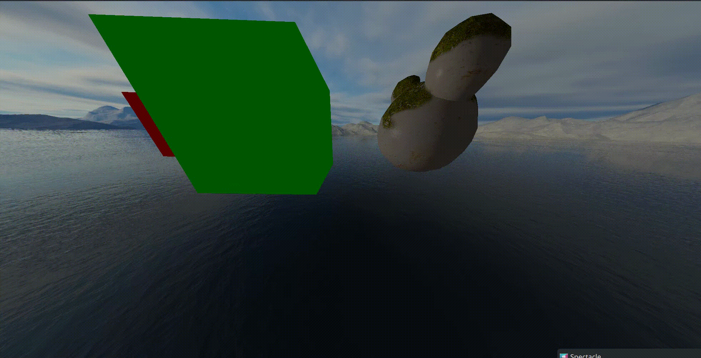
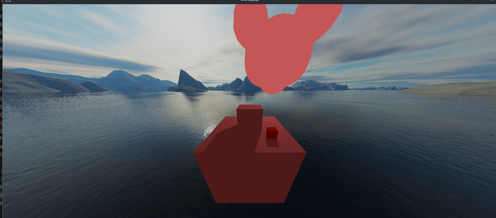
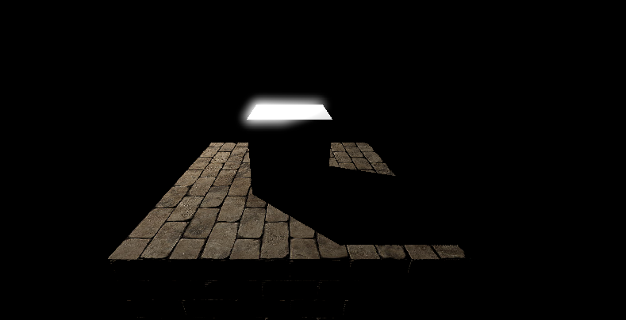

# A 3D graphics rendering library (Rust + OpenGL)

This project evolved from a learning exercise into a thoughtfully designed graphics engine capable of rendering 3D games and graphical simulations. Built with deliberate type-safety constraints: invalid GPU operations *will not compile*.

I implemented everything from scratch—custom linear algebra, data structures, rendering abstractions—using external crates only where infeasible (glfw, gl).

## Architecture

* Type safety: Compile-time guarantees for valid GPU state; zero runtime panics in hot paths.
* Zero-cost abstractions: Zero-sized types and compile-time specialization eliminate runtime overhead.
* Code quality: Production-grade linting. Clippy compliance enforced.
* Modular design: Custom crates from linear algebra to scene management; each independently usable.

## Design Philosophy

Built to leverage Rust's type system for correctness: invalid GPU operations fail at compile time, not runtime. This constraint shaped every architectural decision—from type-safe draw operations to zero-sized compile-time guarantees. The result is a rendering library where entire classes of graphics bugs become uncompileable.

## Getting started

See [`template_app`](./template_app/) for a minimal example implementing the `ApiState` trait.

## Examples

* [`triangle_test`](./triangle_test/) - Minimal triangle rendered with transformations and collision detection
  
* [`grappling_hook`](./grappling_hook/) - Interactive scene with collision and constraints
  
* [`box_with_sun`](./box_with_sun/) - Lit scene with multiple light sources and skybox.
  
* [`deferred_test`](./deferred_test/) - List scene demonstrating deferred shading.
  

run with

```bash
cargo run --release --bin <OPTION>
```

### With Nix (recommended)

`nix develop` to enter the flake environment with `cargo`.

### On Windows

Requires `glfw3`, `assimp`, `OpenGL` libraries and Cargo nightly complete 2026-09-01.

## Roadmap

* Full Clippy compliance
* Expanded documentation
* Windows support
* Vulkan support
